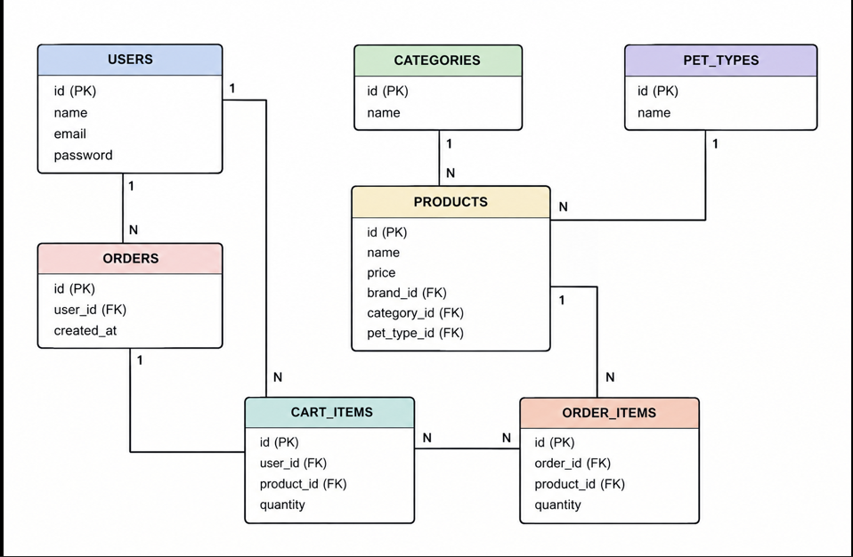

## 🐶 Про проєкт

PetShop допомагає власникам домашніх тварин швидко знайти й замовити все необхідне для свого улюбленця.
Ідея: господар обирає, для кого шукає товар (собака, кіт, гризун, птах, рибки), і одразу бачить лише потрібні товари. Не треба гортати весь асортимент: достатньо вибрати вид тварини, категорію чи бренд.

### Що є на сайті

Каталог товарів з пошуком за назвою, фільтрами (вид тварини, категорія, бренд, ціна) та сортуванням (від найдешевших, від найдорожчих, за популярністю).
Сторінка товару: опис, ціна, фото, бренд, категорія, для якої тварини, наявність.
Сторінка брендів: при переході на бренд видно всі його товари.
Сторінка категорій: при переході на категорію видно всі її товари.
Керування асортиментом: адміністратор додає, редагує та видаляє товари, бренди й категорії.
Реєстрація та вхід.
Профіль: історія замовлень, редагування своїх даних.
Кошик: додати товар, змінити кількість, прибрати зайве.
Замовлення: після натискання «Купити» з товарів кошика створюється замовлення (спрощено: без оплати й додаткових даних).
Сторінка «Про нас»: контакти, доставка, повернення.

### Загальні домовленості API

Дані передаються у форматі JSON (Content-Type: application/json).
Базовий префікс усіх адрес: /api.
В адресах іменники у множині, без дієслів. Дія визначається методом запиту: GET читає, POST створює, PUT оновлює, DELETE видаляє.
Списки підтримують пагінацію: ?page=1&limit=20.
Помилки повертаються у форматі:
json
{ "error": "Опис помилки" }
Використовувані коди відповідей: 200 OK, 201 Created, 204 No Content, 400 Bad Request, 401 Unauthorized, 403 Forbidden, 404 Not Found, 409 Conflict.

#### Усі ендпоінти коротко

Метод   Адреса                        Опис                                             Доступ
GET     /api/products                 Список товарів (пошук, фільтри, сортування)      всі
GET     /api/products/{id}            Один товар                                       всі
POST    /api/products                 Створити товар                                   admin
PUT     /api/products/{id}            Оновити товар                                    admin
DELETE  /api/products/{id}            Видалити товар                                   admin
GET     /api/brands                   Список брендів                                   всі
GET     /api/brands/{id}              Один бренд                                       всі
GET     /api/brands/{id}/products     Товари бренду                                    всі
POST    /api/brands                   Створити бренд                                   admin
PUT     /api/brands/{id}              Оновити бренд                                    admin
DELETE  /api/brands/{id}              Видалити бренд                                   admin
GET     /api/categories               Список категорій                                 всі
GET     /api/categories/{id}/products Товари категорії                                 всі
POST    /api/categories               Створити категорію                               admin
PUT     /api/categories/{id}          Оновити категорію                                admin
DELETE  /api/categories/{id}          Видалити категорію                               admin
GET     /api/pet-types                Види тварин (для фільтра)                        всі
POST    /api/auth/register            Реєстрація                                       всі
POST    /api/auth/login               Вхід                                             всі
GET     /api/users/me                 Мій профіль                                      auth
PUT     /api/users/me                 Редагувати мій профіль                           auth
GET     /api/cart                     Мій кошик                                        auth
POST    /api/cart/items               Додати товар у кошик                             auth
PATCH   /api/cart/items/{productId}   Змінити кількість товару в кошику                auth
DELETE  /api/cart/items/{productId}   Прибрати товар з кошика                          auth
POST    /api/orders                   Створити замовлення з кошика                     auth
GET     /api/orders                   Мої замовлення                                   auth
GET     /api/orders/{id}              Деталі мого замовлення                           auth
GET     /api/about                    Інформація «Про нас»                             всі

### Детальний опис ендпоінтів

#### Товари

 
<code>GET /api/products</code> — список товарів

Повертає список товарів з коротким описом (повна інформація доступна в GET /api/products/{id}).
Query-параметри (усі необов'язкові):
Параметр Опис
search     пошук за назвою
petTypeId фільтр за видом тварини
categoryId фільтр за категорією
brandId     фільтр за брендом
minPrice,   maxPrice діапазон ціни
sort     price_asc, price_desc, popularity
page,       limit пагінація

#### Response 200 OK

{
  "items": [
    {
      "id": 1,
      "name": "Сухий корм для собак Premium",
      "price": 450.00,
      "imageUrl": "https://example.com/img/1.jpg",
      "brand": { "id": 3, "name": "HappyPaws" },
      "category": { "id": 2, "name": "Корм" },
      "petType": { "id": 1, "name": "Собаки" }
    }
  ],
  "page": 1,
  "limit": 20,
  "total": 57
}

 
 
<code>GET /api/products/{id}</code> — один товар

#### Response 200 OK

{
  "id": 1,
  "name": "Сухий корм для собак Premium",
  "description": "Повнораціонний корм для дорослих собак середніх порід.",
  "price": 450.00,
  "stock": 25,
  "imageUrl": "<https://example.com/img/1.jpg>",
  "brand": { "id": 3, "name": "HappyPaws" },
  "category": { "id": 2, "name": "Корм" },
  "petType": { "id": 1, "name": "Собаки" }
}

#### Response 404 Not Found: товару не існує

 
 
<code>POST /api/products</code> — створити товар <b>(admin)</b>

{
  "name": "Іграшка-м'ячик для котів",
  "description": "М'який м'ячик з брязкальцем.",
  "price": 85.00,
  "stock": 100,
  "imageUrl": "<https://example.com/img/2.jpg>",
  "brandId": 3,
  "categoryId": 4,
  "petTypeId": 2
}

#### Response 201 Created

створений товар (формат як у GET /api/products/{id}).

#### Response 400 Bad Request

некоректні дані.

#### Response 401 / 403

немає входу або прав.

 
 
<code>PUT /api/products/{id}</code> — оновити товар <b>(admin)</b>

Request body: як у POST /api/products. Response 200 OK: оновлений товар. Response 404 Not Found: товару не існує.

 
 
<code>DELETE /api/products/{id}</code> — видалити товар <b>(admin)</b>

Response 204 No Content. Response 404 Not Found: товару не існує.

### Бренди

 
<code>GET /api/brands</code>, <code>GET /api/brands/{id}</code> — читання брендів

GET /api/brands → 200 OK:

[ { "id": 3, "name": "HappyPaws", "country": "Німеччина" } ]

GET /api/brands/{id} → 200 OK:

{ "id": 3, "name": "HappyPaws", "country": "Німеччина", "description": "Корми та аксесуари для тварин." }

404 Not Found: бренду не існує.

 
 
<code>GET /api/brands/{id}/products</code> — товари бренду

Query-параметри: sort, page, limit. Response 200 OK: як у GET /api/products. Response 404 Not Found: бренду не існує.

 
 
<code>POST</code>, <code>PUT</code>, <code>DELETE</code> для брендів <b>(admin)</b>

POST /api/brands, request body:
{ "name": "HappyPaws", "country": "Німеччина", "description": "Корми та аксесуари для тварин." }

Response 201 Created: створений бренд.

PUT /api/brands/{id}: body як у POST, response 200 OK з оновленим брендом, або 404 Not Found.

DELETE /api/brands/{id}: response 204 No Content, 404 Not Found, або 409 Conflict, якщо у бренду є товари.

### Категорії

 
<code>GET /api/categories</code>, <code>GET /api/categories/{id}/products</code> — читання

GET /api/categories → 200 OK:
[ { "id": 2, "name": "Корм" }, { "id": 4, "name": "Іграшки" } ]

GET /api/categories/{id}/products: query sort, page, limit; response 200 OK як у GET /api/products, або 404 Not Found.

 
 
<code>POST</code>, <code>PUT</code>, <code>DELETE</code> для категорій <b>(admin)</b>

POST /api/categories, request body:
{ "name": "Іграшки" }

Response 201 Created: { "id": 4, "name": "Іграшки" }.

PUT /api/categories/{id}: body { "name": "Іграшки та ігри" }, response 200 OK або 404 Not Found.

DELETE /api/categories/{id}: response 204 No Content, 404 Not Found, або 409 Conflict, якщо в категорії є товари.

### Види тварин

 
<code>GET /api/pet-types</code> — види тварин для фільтра

Response 200 OK:
[ { "id": 1, "name": "Собаки" }, { "id": 2, "name": "Коти" }, { "id": 3, "name": "Гризуни" } ]

### Авторизація та профіль

 
<code>POST /api/auth/register</code> — реєстрація

Request body:
{ "name": "Поліна Костюк", "email": "<polina@gmail.com>", "password": "securePassword123" }
Response 201 Created:
{ "id": 10, "name": "Поліна Костюк", "email": "<polina@gmail.com.com>" }

Response 400 Bad Request: некоректні дані. Response 409 Conflict: такий email уже зареєстрований.

 
 
<code>POST /api/auth/login</code> — вхід

Request body:
{ "email": "<polina@gmail.com>", "password": "securePassword123" }

Response 200 OK: { "token": "..." } Response 401 Unauthorized: невірний email або пароль.

[!NOTE] Формат токена та механізм авторизації будуть уточнені на етапі реалізації авторизації.

 
 
<code>GET /api/users/me</code>, <code>PUT /api/users/me</code> — профіль <b>(auth)</b>

GET /api/users/me → 200 OK:
{ "id": 10, "name": "Поліна Костюк", "email": "<polina@gmail.com>", "phone": "+380636667788" }

PUT /api/users/me, request body:
{ "name": "Поліна Костюк", "phone": "+380636667788" }

Response 200 OK: оновлений профіль. Для обох: 401 Unauthorized, якщо немає входу.

### Кошик

 
<code>GET /api/cart</code> — мій кошик <b>(auth)</b>

Response 200 OK:
{
  "items": [
    { "productId": 1, "name": "Сухий корм для собак Premium", "price": 450.00, "quantity": 2 }
  ],
  "totalPrice": 900.00
}

 
 
<code>POST /api/cart/items</code> — додати товар <b>(auth)</b>

Request body: { "productId": 1, "quantity": 2 } Response 201 Created: оновлений кошик (формат як у GET /api/cart). Response 404 Not Found: товару не існує.

 
 
<code>PATCH /api/cart/items/{productId}</code> — змінити кількість <b>(auth)</b>

Request body: { "quantity": 3 } Response 200 OK: оновлений кошик. Response 404 Not Found: товару немає в кошику.

 
 
<code>DELETE /api/cart/items/{productId}</code> — прибрати товар <b>(auth)</b>

Response 204 No Content. Response 404 Not Found: товару немає в кошику.

### Замовлення

 
<code>POST /api/orders</code> — створити замовлення з кошика <b>(auth)</b>

Тіло запиту відсутнє. Замовлення створюється з усіх товарів кошика, після чого кошик очищується.
Response 201 Created:
{
  "id": 55,
  "status": "NEW",
  "createdAt": "2026-10-13T18:30:00Z",
  "totalPrice": 900.00,
  "items": [
    { "productId": 1, "name": "Сухий корм для собак Premium", "price": 450.00, "quantity": 2 }
  ]
}

Response 400 Bad Request: кошик порожній.

 
 
<code>GET /api/orders</code>, <code>GET /api/orders/{id}</code> — мої замовлення <b>(auth)</b>

GET /api/orders → 200 OK:
[ { "id": 55, "status": "NEW", "createdAt": "2026-10-13T18:30:00Z", "totalPrice": 900.00 } ]

GET /api/orders/{id} → 200 OK: формат як у відповіді POST /api/orders. 404 Not Found: замовлення не існує або належить іншому користувачу.

### Про нас

 
<code>GET /api/about</code> — контакти, доставка, повернення

Response 200 OK:

{
  "contacts": {
    "phone": "+380634445566",
    "email": "<info@petshop.example>",
    "address": "м. Київ, вул. Свободв, 45"
  },
  "delivery": "Нова пошта, 1-3 дні.",
  "returns": "Повернення протягом 14 днів."
}

