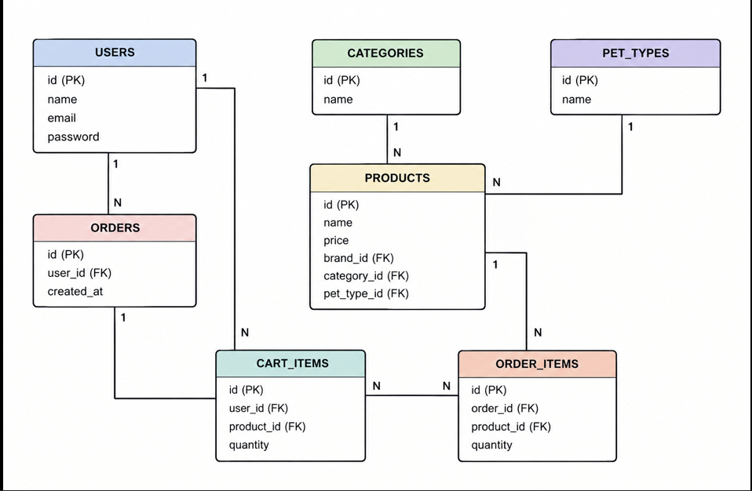

## 🐶 Про проєкт

PetShop допомагає власникам домашніх тварин швидко знайти й замовити все необхідне для свого улюбленця.
Ідея: господар обирає, для кого шукає товар (собака, кіт, гризун, птах, рибки), і одразу бачить лише потрібні товари. Не треба гортати весь асортимент: достатньо вибрати вид тварини, категорію чи бренд.

### Що реалізовано зараз

| Частина | Стан |
|---|---|
| Каталог: категорії, бренди, товари (CRUD API) | реалізовано |
| Реєстрація, вхід (JWT), оновлення токена, профіль, права доступу (admin / користувач) | реалізовано |
| Автотести, покриття, документація OpenAPI (Swagger UI), логування, `.env` | реалізовано |
| Фронтенд: каталог, реєстрація, вхід, профіль | реалізовано (окремий репозиторій) |
| Пошук, фільтри, пагінація, види тварин, кошик, замовлення, «Про нас» | заплановано (див. розділ «Запланований функціонал» унизу) |

## Як запустити проєкт

Потрібні Python 3.12+ та Git.

```bash
git clone https://github.com/polinakostiuk/Petshop.git
cd Petshop
python3 -m venv venv
source venv/bin/activate
pip install -r requirements.txt
cp .env.example .env              
python manage.py migrate
python manage.py createsuperuser 
python manage.py runserver 8000
```

Без файлу `.env` проєкт не запуститься: Django попросить задати `SECRET_KEY`.

API доступне за адресою http://127.0.0.1:8000/api/, наприклад http://127.0.0.1:8000/api/products

Фронтенд лежить в окремому репозиторії: [Petshop-frontend](https://github.com/polinakostiuk/Petshop-frontend). Він працює на порту 3000, тому налаштований CORS (`CORS_ALLOWED_ORIGINS` у `.env`).

## Змінні середовища (.env)

Секретні та залежні від комп'ютера налаштування лежать у файлі `.env`. Він додано до `.gitignore`, тому в Git не потрапляє. У репозиторії є лише шаблон `.env.example` без справжніх секретів. Значення читаються в `config/settings.py` бібліотекою `python-dotenv`.

| Змінна | Що це | Приклад |
|---|---|---|
| `SECRET_KEY` | секретний ключ Django, ним же підписуються JWT-токени. **Обов'язкова** | довгий випадковий рядок |
| `DEBUG` | режим розробки (`True` лише локально, на сервері `False`) | `True` |
| `ALLOWED_HOSTS` | дозволені адреси сервера через кому | `127.0.0.1,localhost` |
| `CORS_ALLOWED_ORIGINS` | адреси фронтенду, яким дозволено звертатися до API, через кому | `http://127.0.0.1:3000,http://localhost:3000` |
| `LOG_LEVEL` | рівень логування: `DEBUG`, `INFO`, `WARNING`, `ERROR` | `INFO` |

Підготувати локальне середовище:

```bash
cp .env.example .env
# згенерувати власний секретний ключ і вписати його в .env як SECRET_KEY
python -c "from django.core.management.utils import get_random_secret_key as k; print(k())"
```

## Тести

Тести перевіряють основні сценарії ресурсу **товари** (`/api/products`): читання, створення, повну заміну (PUT), видалення, а також негативні сценарії: некоректні дані (`400`), неіснуючий id (`404`), дії без токена (`401`) і зі звичайним користувачем (`403`), метод PATCH (`405`), видалення категорії чи бренду з товарами (`409`). Окремо перевіряються логування й відкриття документації.

Дані для тестів готують **фікстури**: файл `pets/fixtures/catalog.json` (3 категорії, 3 бренди, 3 товари) і користувачі, яких створює `setUpTestData`. Перед кожним тестом база повертається до цього стану.

```bash
python manage.py test              
python manage.py test pets         
python manage.py test users       
```

### Покриття тестами

Покриття вимірюється інструментом `coverage.py` (налаштування в `.coveragerc`):

```bash
coverage run manage.py test     
coverage report                    
coverage html                      
```

## Документація API (OpenAPI)

Документація генерується автоматично бібліотекою `drf-spectacular` і завжди відповідає реальному коду. Запустіть сервер і відкрийте:

* **Swagger UI**: http://127.0.0.1:8000/api/docs/ (можна пробувати запити прямо на сторінці)
* **ReDoc**: http://127.0.0.1:8000/api/redoc/
* **OpenAPI-схема** (YAML): http://127.0.0.1:8000/api/schema/

Файл схеми вже лежить у репозиторії (`schema.yml`), його можна відкрити на https://editor.swagger.io. Оновити його:

```bash
python manage.py spectacular --file schema.yml
```

Для захищених запитів у Swagger UI: виконайте `POST /api/auth/login`, скопіюйте значення `access`, натисніть кнопку **Authorize** і вставте токен (слово `Bearer` писати не треба). Для кожного ендпоінта ресурсів **Товари**, **Бренди**, **Категорії** та **Авторизація** описано адресу, метод, параметри, структуру запиту й відповіді, приклади, коди помилок і вимоги до авторизації.

## Логування

Логи пишуться в консоль і у файл `logs/petshop.log` (до 1 МБ, лишається 3 старі копії; папка в `.gitignore`). Рівень задає змінна `LOG_LEVEL`.

| Рівень | Що логується | Приклад |
|---|---|---|
| `DEBUG` | дрібні подробиці | `/api/products: список, об'єктів - 3` |
| `INFO` | важливі успішні події | `POST /api/products: створено id=4 користувачем admin`, `Користувач anna увійшов (id=2)` |
| `WARNING` | клієнт зробив щось не так, сервер працює нормально | `Невдала спроба входу для anna`, `/api/products/999: об'єкт id=999 не знайдено`, `DELETE ... заборонено для anna`, `токен відхилено: Термін дії токена закінчився.` |
| `ERROR` | збій на сервері (500) разом із трасуванням | `Необроблена помилка під час GET /api/...` |

**Паролі, токени та інші чутливі дані в логи не потрапляють:** логуються лише імена користувачів, id об'єктів, адреси запитів і причини відмов. Це перевіряють автотести.

## Postman

Колекція лежить у `postman/petshop.postman_collection.json`. Імпортуйте її в Postman (**Import**) і запустіть **Run collection**. Адреса сервера задана змінною `base_url` (за замовчуванням `http://127.0.0.1:8000`). У колекції є приклади успішних відповідей та помилок `400`, `401`, `403`, `404`, `409`.

Порядок: спочатку папка **0 Вхід адміністратора**. Вона логіниться під адміністратором (змінні колекції `admin_username` і `admin_password`; змініть їх на дані свого суперкористувача з `createsuperuser`) і зберігає `admin_access_token`. З цим токеном працюють створення, редагування й видалення в папках 1-5.

Папка **6 Реєстрація, вхід і права доступу** містить реєстрацію, логін, профіль, оновлення access за refresh, а також приклади `401` і `403`.

## Загальні домовленості API

* Дані передаються у форматі JSON (`Content-Type: application/json`).
* Базовий префікс усіх адрес: `/api`. Адреси без `/` в кінці.
* В адресах іменники у множині, без дієслів. Дію визначає метод запиту: `GET` читає, `POST` створює, `PUT` повністю замінює, `DELETE` видаляє. Часткового оновлення (`PATCH`) немає, на нього відповідь `405`.
* Списки повертаються цілим масивом, відсортованим за `id` (пагінації поки немає).
* Захищені запити потребують заголовок `Authorization: Bearer <access-токен>` (див. розділ «Авторизація та права доступу»).
* Використовувані коди відповідей: `200 OK`, `201 Created`, `204 No Content`, `400 Bad Request`, `401 Unauthorized`, `403 Forbidden`, `404 Not Found`, `405 Method Not Allowed`, `409 Conflict`.

### Помилки

Усі помилки мають однаковий формат: `{"error": "..."}`. Для `400` додається `details` з описом проблеми по полях.

| Код | Коли | Приклад відповіді |
|---|---|---|
| `400` | некоректні дані (порожня назва, ціна менше 0.01, неіснуючий `category`/`brand`, повторна назва, зламаний JSON) | `{"error": "Некоректні дані.", "details": {"name": ["Це поле не може бути порожнім."]}}` |
| `401` | немає access-токена, він прострочений або неправильний; невірний логін чи пароль | `{"error": "Потрібна авторизація. Увійдіть і передайте access-токен у заголовку Authorization: Bearer <токен>."}` |
| `403` | користувач увійшов, але не адміністратор | `{"error": "Недостатньо прав: цю дію може виконати лише адміністратор."}` |
| `404` | об'єкта з таким `id` немає | `{"error": "Товар з id=999999 не знайдено."}` |
| `405` | метод не підтримується (наприклад, `PATCH`) | `{"error": "..."}` |
| `409` | не можна видалити категорію чи бренд, у яких є товари | `{"error": "Неможливо видалити категорію «Корм»: до неї належить товарів - 1."}` |

### Усі ендпоінти коротко

| Метод | Адреса | Опис | Доступ |
|---|---|---|---|
| GET | `/api/products` | Список товарів | всі |
| GET | `/api/products/{id}` | Один товар | всі |
| POST | `/api/products` | Створити товар | admin |
| PUT | `/api/products/{id}` | Замінити товар | admin |
| DELETE | `/api/products/{id}` | Видалити товар | admin |
| GET | `/api/brands` | Список брендів | всі |
| GET | `/api/brands/{id}` | Один бренд | всі |
| POST | `/api/brands` | Створити бренд | admin |
| PUT | `/api/brands/{id}` | Замінити бренд | admin |
| DELETE | `/api/brands/{id}` | Видалити бренд | admin |
| GET | `/api/categories` | Список категорій | всі |
| GET | `/api/categories/{id}` | Одна категорія | всі |
| POST | `/api/categories` | Створити категорію | admin |
| PUT | `/api/categories/{id}` | Замінити категорію | admin |
| DELETE | `/api/categories/{id}` | Видалити категорію | admin |
| POST | `/api/auth/register` | Реєстрація | всі |
| POST | `/api/auth/login` | Вхід (повертає `access` і `refresh`) | всі |
| POST | `/api/auth/refresh` | Новий `access` за `refresh` | всі |
| GET | `/api/users/me` | Мій профіль | потрібен вхід |

## Детальний опис ендпоінтів

Те саме в інтерактивному вигляді: Swagger UI (`/api/docs/`).

### Товари

Поля товару: `id`, `name`, `description`, `price`, `stock`, `created_at`, `category`, `brand` (це id категорії та бренду), а також `category_name` і `brand_name` (лише для читання). Ціна повертається **рядком** (`"349.90"`), щоб не втрачати точність.

<details> <summary><code>GET /api/products</code> — список товарів</summary>

Токен не потрібен. Query-параметрів поки немає. Відповідь `200 OK` (масив, відсортований за `id`):

```json
[
  {
    "id": 1,
    "category_name": "Корм",
    "brand_name": "Acana",
    "name": "Сухий корм для собак, 2 кг",
    "description": "Корм для дорослих собак середніх порід",
    "price": "349.90",
    "stock": 25,
    "created_at": "2026-11-09T19:00:00Z",
    "category": 1,
    "brand": 1
  }
]
```

</details>

<details> <summary><code>GET /api/products/{id}</code> — один товар</summary>

Токен не потрібен.

* `200 OK`: один об'єкт у тому самому форматі, що й елемент списку.
* `404 Not Found`: `{"error": "Товар з id=999999 не знайдено."}`

</details>

<details> <summary><code>POST /api/products</code> — створити товар <b>(admin)</b></summary>

Заголовок: `Authorization: Bearer <access-токен адміністратора>`.

| Поле | Обов'язкове | Правила |
|---|---|---|
| `name` | так | до 200 символів, не порожнє |
| `description` | ні | текст |
| `price` | так | число не менше 0.01, до 2 знаків після коми |
| `stock` | ні | ціле число не менше 0 (за замовчуванням 0) |
| `category` | так | id існуючої категорії |
| `brand` | так | id існуючого бренду |

Request body:

```json
{
  "name": "Сухий корм для собак, 2 кг",
  "description": "Корм для дорослих собак середніх порід",
  "price": "349.90",
  "stock": 25,
  "category": 1,
  "brand": 1
}
```

* `201 Created`: створений товар (формат як у `GET /api/products/{id}`).
* `400 Bad Request`: некоректні дані, `{"error": "Некоректні дані.", "details": {"name": ["Це поле не може бути порожнім."]}}`. Також `400`, якщо тіло не є правильним JSON: `{"error": "Некоректний JSON."}`.
* `401`: немає токена або він неправильний.
* `403`: користувач не адміністратор.

</details>

<details> <summary><code>PUT /api/products/{id}</code> — замінити товар <b>(admin)</b></summary>

`PUT` замінює об'єкт повністю: усі обов'язкові поля треба передати знову (формат тіла як у `POST`).

* `200 OK`: оновлений товар.
* `400 Bad Request`: некоректні дані або зламаний JSON.
* `401` / `403`: немає входу або прав.
* `404 Not Found`: товару не існує.
* `PATCH` не підтримується: `405`.

</details>

<details> <summary><code>DELETE /api/products/{id}</code> — видалити товар <b>(admin)</b></summary>

* `204 No Content`: видалено, тіла відповіді немає.
* `401` / `403`: немає входу або прав.
* `404 Not Found`: товару не існує.

</details>

### Бренди

Поля: `id`, `name` (унікальне, до 100 символів), `country` (необов'язкове).

<details> <summary><code>GET /api/brands</code>, <code>GET /api/brands/{id}</code> — читання</summary>

Токен не потрібен.

`GET /api/brands` → `200 OK`:

```json
[ { "id": 1, "name": "Acana", "country": "Канада" } ]
```

`GET /api/brands/{id}` → `200 OK`: один об'єкт, або `404`: `{"error": "Бренд з id=999 не знайдено."}`.

</details>

<details> <summary><code>POST</code>, <code>PUT</code>, <code>DELETE</code> для брендів <b>(admin)</b></summary>

`POST /api/brands`, request body: `{ "name": "Acana", "country": "Канада" }`. Відповіді: `201 Created` (створений бренд), `400` (порожня або повторна назва), `401`, `403`.

`PUT /api/brands/{id}`: тіло як у `POST`, відповіді `200 OK`, `400`, `401`, `403`, `404`.

`DELETE /api/brands/{id}`: `204 No Content`, `401`, `403`, `404`, або `409 Conflict`, якщо у бренду є товари: `{"error": "Неможливо видалити бренд «Acana»: з ним пов'язано товарів - 1."}`.

</details>

### Категорії

Поля: `id`, `name` (унікальне, до 100 символів), `description` (необов'язкове).

<details> <summary><code>GET /api/categories</code>, <code>GET /api/categories/{id}</code> — читання</summary>

Токен не потрібен.

`GET /api/categories` → `200 OK`:

```json
[ { "id": 1, "name": "Корм", "description": "Корм для тварин" } ]
```

`GET /api/categories/{id}` → `200 OK`: один об'єкт, або `404`: `{"error": "Категорію з id=999 не знайдено."}`.

</details>

<details> <summary><code>POST</code>, <code>PUT</code>, <code>DELETE</code> для категорій <b>(admin)</b></summary>

`POST /api/categories`, request body: `{ "name": "Корм", "description": "Корм для тварин" }`. Відповіді: `201 Created`, `400` (порожня або повторна назва), `401`, `403`.

`PUT /api/categories/{id}`: тіло як у `POST`, відповіді `200 OK`, `400`, `401`, `403`, `404`.

`DELETE /api/categories/{id}`: `204 No Content`, `401`, `403`, `404`, або `409 Conflict`, якщо в категорії є товари: `{"error": "Неможливо видалити категорію «Корм»: до неї належить товарів - 1."}`.

</details>



## Авторизація та права доступу

Реалізовано в окремому Django app `users`: реєстрація, вхід із JWT, оновлення токена, профіль і обмеження доступу.

**Як це працює.**

1. Користувач реєструється (`POST /api/auth/register`). Пароль у базі зберігається лише у вигляді хешу (PBKDF2).
2. Входить (`POST /api/auth/login`) і отримує два JWT-токени:
   * `access` живе **5 хвилин**; його треба передавати в кожному запиті до захищених ендпоінтів;
   * `refresh` живе **7 днів**; потрібен лише для отримання нового `access`.
3. Токен передається в заголовку: `Authorization: Bearer <access-токен>`.
4. Коли `access` закінчується, захищений запит повертає `401`. Клієнт один раз викликає `POST /api/auth/refresh` зі збереженим `refresh`, отримує новий `access` і повторює запит. Коли закінчується і `refresh`, потрібно увійти знову.
5. **Вихід (logout)** виконується на клієнті: збережені токени видаляються. Окремого запиту до сервера немає.

Токен підписується секретним ключем `SECRET_KEY` (HS256), підробити його без ключа неможливо. У токені лежать лише `user_id`, тип (`access`/`refresh`) і час дії, а не пароль. Refresh-токен не можна використати як access і навпаки.

<details> <summary><code>POST /api/auth/register</code> — реєстрація</summary>

Заголовки: `Content-Type: application/json`. Токен не потрібен.

| Поле | Обов'язкове | Правила |
|---|---|---|
| `username` | так | до 150 символів; літери, цифри, `@ . + - _`; унікальне |
| `first_name` | ні | до 150 символів |
| `last_name` | ні | до 150 символів |
| `email` | так | коректний формат; унікальний |
| `password` | так | мінімум 8 символів, не надто поширений, не лише цифри |
| `password_confirmation` | так | має збігатися з `password` |

Request body:

```json
{
  "username": "anna",
  "first_name": "Анна",
  "last_name": "Коваль",
  "email": "anna@example.com",
  "password": "Str0ng-pass-2026",
  "password_confirmation": "Str0ng-pass-2026"
}
```

Response `201 Created` (пароль не повертається):

```json
{
  "id": 2,
  "username": "anna",
  "first_name": "Анна",
  "last_name": "Коваль",
  "email": "anna@example.com",
  "is_staff": false,
  "date_joined": "2026-11-09T19:00:00Z"
}
```

Response `400 Bad Request`: помилка для кожного поля окремо:

```json
{
  "error": "Некоректні дані.",
  "details": {
    "email": ["Введіть коректну адресу електронної пошти."],
    "password_confirmation": ["Паролі не збігаються."]
  }
}
```

</details>

<details> <summary><code>POST /api/auth/login</code> — вхід</summary>

Request body: `{ "username": "anna", "password": "Str0ng-pass-2026" }`

Response `200 OK`:

```json
{
  "access": "eyJhbGciOiJIUzI1NiIs...",
  "refresh": "eyJhbGciOiJIUzI1NiIs...",
  "user": { "id": 2, "username": "anna", "first_name": "Анна", "last_name": "Коваль", "email": "anna@example.com", "is_staff": false, "date_joined": "2026-11-09T19:00:00Z" }
}
```

Response `400`: не передано `username` або `password`.
Response `401`: `{"error": "Невірне ім'я користувача або пароль."}`

</details>

<details> <summary><code>POST /api/auth/refresh</code> — новий access-токен</summary>

Request body: `{ "refresh": "eyJhbGciOiJIUzI1NiIs..." }`

Response `200 OK`: `{ "access": "eyJhbGciOiJIUzI1NiIs..." }`

Response `400`: не передано `refresh`.
Response `401`: refresh прострочений, пошкоджений або це access-токен.

</details>

<details> <summary><code>GET /api/users/me</code> — мій профіль <b>(потрібен вхід)</b></summary>

Заголовок: `Authorization: Bearer <access-токен>`

Response `200 OK`: об'єкт користувача (як у відповіді реєстрації).
Response `401`: немає токена, він прострочений чи неправильний.

</details>

**Хто що може.**

| Дія | Анонім | Користувач | Адміністратор |
|---|:---:|:---:|:---:|
| `GET` товарів, брендів, категорій | так | так | так |
| `POST`, `PUT`, `DELETE` товарів, брендів, категорій | `401` | `403` | так |
| `GET /api/users/me` | `401` | так | так |
| реєстрація, вхід, оновлення токена | так | так | так |

Адміністратор: користувач з `is_staff = True`, його створює `python manage.py createsuperuser`. `401` означає «ви не увійшли», `403` означає «ви увійшли, але прав недостатньо».

## Запланований функціонал (ще не реалізовано)

Нижче те, що входить у задум проєкту, але в API ще немає. Ці адреси **не працюють**, їх не слід шукати в Swagger.

**Що буде на сайті.** Каталог товарів з пошуком за назвою, фільтрами (вид тварини, категорія, бренд, ціна) та сортуванням. Сторінки брендів і категорій зі списком їхніх товарів. Керування асортиментом для адміністратора на сайті. Профіль з історією замовлень і редагуванням даних. Кошик і замовлення (спрощено: без оплати). Сторінка «Про нас»: контакти, доставка, повернення.

**Планові ендпоінти.**

| Метод | Адреса | Опис |
|---|---|---|
| GET | `/api/brands/{id}/products` | Товари бренду |
| GET | `/api/categories/{id}/products` | Товари категорії |
| GET | `/api/pet-types` | Види тварин (для фільтра) |
| PUT | `/api/users/me` | Редагувати мій профіль |
| GET | `/api/cart` | Мій кошик |
| POST | `/api/cart/items` | Додати товар у кошик |
| PATCH | `/api/cart/items/{productId}` | Змінити кількість |
| DELETE | `/api/cart/items/{productId}` | Прибрати товар з кошика |
| POST | `/api/orders` | Створити замовлення з кошика |
| GET | `/api/orders` | Мої замовлення |
| GET | `/api/orders/{id}` | Деталі мого замовлення |
| GET | `/api/about` | Інформація «Про нас» |

Також заплановано пошук, фільтри та пагінацію (`?page=1&limit=20`) для `GET /api/products`.